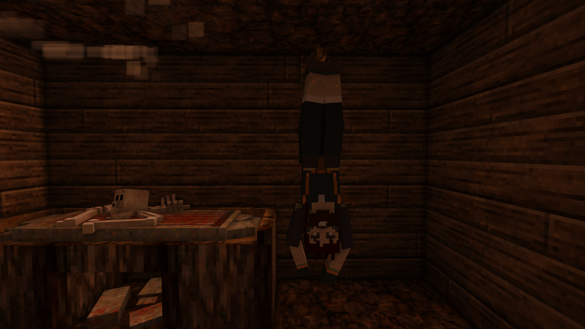

# Outlaws × Butchering



*Русское описание: [release/modpage_ru.md](release/modpage_ru.md).*

*The roads are not safe. Bandits wait in the tall grass, deserters wander under banners that were never theirs, and the poachers keep dogs that have already tasted blood.*

*Winter comes for everyone. Surviving the ambush is only half of it — there is still the cold to get through. And the body at your feet is heavy, still warm, and full of meat. No one will ask where it came from.*

*Hang it on the hook. Let it bleed. Take the hide. Keep the head: someone may still want to see it.*

---

This mod makes the humans and hounds of **Outlaw Mod** butcherable with the **Butchering** mod.

## How it works

1. Kill an outlaw or a hound and pick up the body. It goes into the back slot and slows you down, like a wolf carcass.
2. Butcher it one of two ways:
   - **On the spot:** a small amount of meat and fat.
   - **Hook and table:** hang the body on the butcher hook (it hangs head down), bleed it, skin it, then finish it on the butcher table. Full yield plus sinew and offal; a pile of bones is left behind.
3. Every human body drops **exactly one head**, whichever way it is butchered. Outlaw Mod's Symbols of Justice keep working.

## What you get

| From | Drops |
|---|---|
| **Humans**: bandits (axe, knife, spear), deserters (archer, footman, bannerman), looter, poachers (archer, spear), yeoman | "long pork" ~7, fat, human hide, sinew ~3, offal ~1.6, one head |
| **Hounds**: feral and hunting | bushmeat ~4, medium hide, fat, sinew ~2.5, offal ~1.4 |

- **Long pork** is meat that sits between bushmeat and red meat in nutrition. You can cook it, cure it in a barrel with salt, and put it in stews, soups and pies.
- **Human hide** goes through the normal hide chain: scraping, soaking, tanning.
- Each body has its own models for lying on the ground or the table and for hanging on the hook.

## Expanded Foods support (built in, optional)

If **Expanded Foods** is installed, long pork behaves like bushmeat everywhere in it. Without Expanded Foods this part stays off; nothing else needs to be downloaded.

- part-baked and charred states; oven baking; meat hook aging into aged long pork;
- meat nuggets, smashed and tender meat, breaded meat, sausages (plain, cheese, cured), broth;
- stews, soups and pies.

With Expanded Foods present, support for these mods also turns on by itself when they are installed:

- **EF: Meals**: au gratin, pasta, rice and beans, salads;
- **Sauce-a-lot**: barbecued, Colonel Tso's and wine-glazed long pork;
- **Sammiches**: meat patty, sausage dogs, cutting board slices.

## Requirements

| Mod | Needs |
|---|---|
| Required | Vintage Story 1.22, [Outlaw Mod](https://mods.vintagestory.at/maztec) 1.2.8+, [Butchering](https://mods.vintagestory.at/butchering) 1.14+ |
| Optional | Expanded Foods 2.0 (with A Culinary Artillery); with it, also EF: Meals, Sauce-a-lot, Sammiches |

Install on the **server and every client**: drop the zip into `Mods`. If you used the separate add-on `OutlawsHumanButchering_EF` before, delete it; it is now part of this mod. To remove it, delete the zip. Bodies and long pork that are already in the world will turn into unknown items.

**Tested with:** VS 1.22.7, Outlaw Mod 1.2.8, Butchering 1.14.3, Expanded Foods 2.0.0-dev.17, EF: Meals 1.0.0-dev.9, Sauce-a-lot 2.3.4, Sammiches 1.3.1.

## Tips and known issues

- Outlaw Mod removes outlaws that spawn close to the world spawn during the first days (`StartingSpawnSafeZoneRadius` in `ModConfig/OutlawModConfig.json`), on land claims and near a Symbol of Justice. That includes outlaws spawned with `/entity spawn`.
- Bodies taken from the creative inventory are supported and give the full drops.
- In Expanded Foods pies, long pork looks like bushmeat and mixes with the same ingredients.
- Not covered: Primitive Survival, Acorns and Ancient Tools parts of Expanded Foods.
- Russian and English translations. Sauce-a-lot and Sammiches have no Russian translation of their own, so their long pork items are in English.
- If something breaks, look in `VintagestoryData/Logs/server-main.log` and `client-main.log` for `outlawshumanbutchering`.

## Building from source

Players only need the zip from the [mod page](https://mods.vintagestory.at/) or the GitHub releases. To build it yourself:

1. Tell the tools where the game and the source mods are. Create `local.paths.json` next to this README (it is ignored by git):
   ```json
   {"game": "C:/path/to/Vintagestory", "mods": "C:/path/to/VintagestoryData/Mods"}
   ```
   `mods` must contain `OutlawsMod_1.2.8.zip`, and for the Expanded Foods part also the Expanded Foods, EF: Meals, Sauce-a-lot and Sammiches zips named in `tools/ef.py`. Instead of the file you can set the `VINTAGE_STORY` and `VS_MODS` environment variables.
2. Build the DLL (.NET 10 SDK). The project reads the game folder from `src/local.props` (`<GameDir>`) or `VINTAGE_STORY`:
   ```
   cd src
   dotnet build -c Release
   ```
3. Generate and pack (Python 3.10+, `pip install json5 numpy`):
   ```
   python tools/generate.py   # bodies, poses, long pork, hide, patches, lang
   python tools/ef.py         # Expanded Foods support
   python tools/pack.py       # -> dist/OutlawsHumanButchering_<version>.zip
   ```

Notes:
- `generate.py` does not overwrite body models that already exist, so hand-made poses survive. `--force-shapes` rebuilds all of them, `--force-dead` only the lying ones.
- The hanging pose of the looter was set by hand in VSMC; `python tools/copy_pose.py` copies its bone angles to the other human models.
- `tools/preview_pose.py` renders the lying poses to check that bodies rest on the ground (needs `matplotlib`).

## Credits

- **Outlaw Mod** by Grifthegnome (1.22 port by Maztec). The outlaw and hound bodies use Grifthegnome's models in new poses, with his permission.
- **Butchering** by G3rste, CaptainOats and Vies. This mod plugs into its hook, table and carcass system.
- **Expanded Foods** and **A Culinary Artillery** by l33tmaan and contributors.
- **Sauce-a-lot** by ColonelCalcium; **Sammiches** by Art3m1s.
- The "long pork" idea comes from **Outlaw Meat** by Lancer827.
- Harmony by Andreas Pardeike.

**Made with AI.** This mod was designed and tested by Borland28rus. The code, generators and poses were written with Claude Code (Anthropic, Claude Opus 5.5). The hanging poses of the feral hound and the looter were set by hand in VSMC. No AI-generated art or audio.

## License

The code and data of this mod (C#, JSON patches, recipes, translations, generator scripts, poses) are released under the [MIT License](LICENSE). The outlaw and hound models are by Grifthegnome (Outlaw Mod) and are used with his permission; they are not covered by this license.
